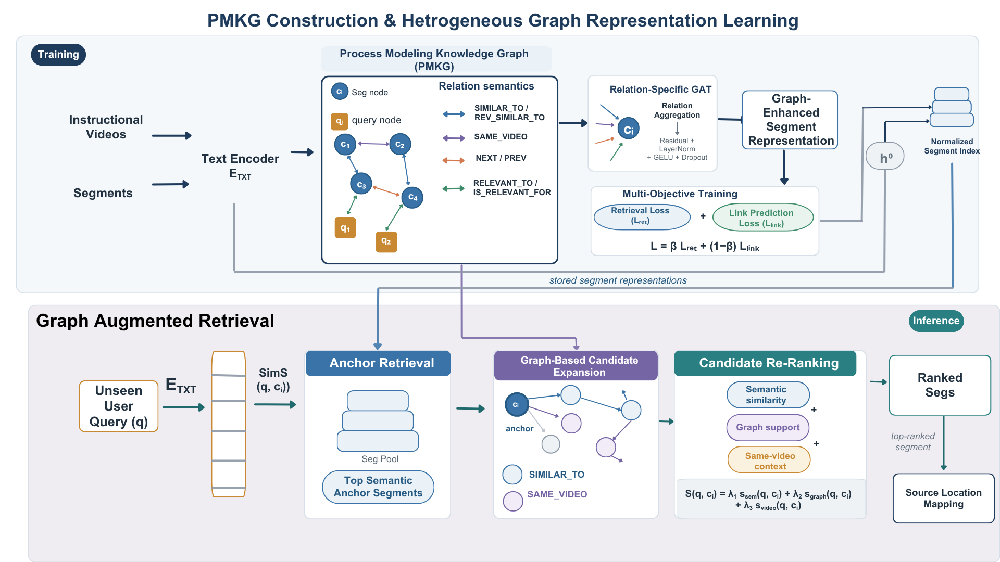

# MR-PMKG: Process-Aware Text-to-Text Moment Retrieval over Multi-Domain Instructional Videos

**Anish Anish, Yaawar Askari, Gorang Mehraishi, Chandramani Chaudhary, Poonam Goyal**

*2026 IEEE International Conference on Big Data (IEEE BigData 2026), short paper*

This repository holds the supplementary material for the paper: the prompts used to build the datasets, the appendix, and the complete result tables.

<!-- Authors: add links to the paper (IEEE Xplore), code and data here when available. -->



## Abstract

Instructional videos contain rich procedural information, but users often seek a specific instructional step rather than an entire video. We address this problem as text-to-text moment retrieval, using transcript-derived text to represent procedural moments. Existing transcript-retrieval approaches typically rank candidate segments independently using lexical or semantic similarity, overlooking the procedural relationships that connect instructional steps within a task. We propose MR-PMKG, a process-aware retrieval framework based on a heterogeneous Process Modeling Knowledge Graph (PMKG). Candidate segments and training queries are represented as graph nodes, while different relations capture semantic similarity, shared source-video context, sequential seg relationships, and supervised query-seg relevance. A heterogeneous graph neural network learns graph-aware representations that combine textual evidence with contextual information from related procedural segments. To support text-to-text moment retrieval, we construct five datasets comprising YouCook-II and four WikiHow categories (Food, Computers, Health, and Sports-Fitness). Experiments against sparse, dense, late-interaction, and LLM-based retrieval baselines show improved ranking quality for fine-grained procedural retrieval, consistent across heterogeneous instructional settings.

## Contents

| Path | What it contains |
|---|---|
| [`appendix/`](appendix/README.md) | A. Segmentation prompt · B. Query-generation prompt · C. Cosine-similarity (no-graph) ablation · D. Pointer to full results |
| [`prompts/`](prompts/README.md) | Plain-text prompts for LLaMA-2 70B (segmentation) and GPT-3.5 Turbo (query generation) |
| [`results/`](results/README.md) | All result tables from the paper as Markdown and CSV, including every cutoff (MRR, Recall@1/5/10, NDCG@1/5/10) |
| [`figures/`](figures/) | Framework overview and the prompt figures |

## Datasets

Five text-to-text moment-retrieval datasets built with one pipeline from two independent sources, YouCook-II and the wikiHow YouTube channel.

| Corpus | Domain | Videos | Segments | Queries |
|---|---|---:|---:|---:|
| YouCook-II | Cooking | 1,366 | 5,428 | 15,699 |
| WikiHow Food | Food | 1,509 | 3,943 | 15,087 |
| WikiHow Computers | Computers | 386 | 1,098 | 3,840 |
| WikiHow Health | Health | 1,113 | 3,292 | 11,101 |
| WikiHow Sports-Fitness | Sports/Fitness | 481 | 1,421 | 4,786 |

**Construction pipeline**

1. **Segmentation.** Each timestamped transcript is split by LLaMA-2 70B into segments (major procedural stages) and sub-segments (finer substeps), each with its text and timestamp. [Prompt](prompts/segmentation_prompt.txt)
2. **Query generation.** GPT-3.5 Turbo generates natural, question-style queries from each transcript, covering both specific steps and broader information needs. The same prompt is used for all corpora. [Prompt](prompts/query_generation_prompt.txt)
3. **Ground truth.** Each sub-segment is represented as *parent segment name + sub-segment text*. For each query, the top 20 sub-segments by cosine similarity are kept, and those with similarity ≥ 0.75 form the initial relevance pool. Human volunteers then check these associations and correct incorrect or ambiguous ones. A query can have several relevant segments.
4. **Storage.** The corpus is stored in Neo4j as Video → segment → sub-segment nodes with text, source-video IDs and timestamps; segment-level records are exported to build the PMKG.

## Method in brief

**PMKG.** Two node types (segments, training queries) and seven relation types:

| Relation | Connects | Meaning |
|---|---|---|
| `SIMILAR_TO` / `REV_SIMILAR_TO` | segment ↔ segment | Cosine similarity ≥ 0.65 and within the top 15 neighbours |
| `SAME_VIDEO` | segment ↔ segment | Segments from the same source video |
| `NEXT` / `PREV` | segment → segment | Consecutive segments within a video |
| `RELEVANT_TO` / `IS_RELEVANT_FOR` | query ↔ segment | Ground-truth relevance (training queries only) |

**Learning.** Relation-specific GAT layers with messages averaged over relation types, residual connection, layer normalization, GELU and dropout. Loss: `L = β·L_ret + (1 − β)·L_link`, where `L_ret` is InfoNCE over query–segment pairs and `L_link` is link prediction on `SIMILAR_TO` edges.

**Retrieval.** Graph and text embeddings are blended (`λ = 0.3`), then: anchor retrieval by cosine similarity → candidate expansion through `SIMILAR_TO` and `SAME_VIDEO` → re-ranking with `S = 0.60·s_sem + 0.25·s_graph + 0.15·s_video`.

## Implementation details

| Setting | Value |
|---|---|
| Hardware | NVIDIA H100 GPU server |
| Text encoder | all-MiniLM-L6-v2 (384-d); BGE-M3 and Qwen3-Embedding also compared |
| GNN | 2 message-passing layers, hidden size 256, 4 attention heads, dropout 0.3 |
| Optimizer | AdamW, learning rate 1e-3, weight decay 1e-4 |
| Training | up to 100 epochs, early-stopping patience 20 |
| Contrastive temperature | 0.1 |
| Loss weight β | 0.7 |
| `SIMILAR_TO` edges | cosine ≥ 0.65, top k = 15 |
| Embedding blend λ | 0.3 |
| Re-ranking weights λ1, λ2, λ3 | 0.60, 0.25, 0.15 |
| Query split | 70 / 15 / 15 (train / validation / test), all positives of a query in the same split |

## Main results

NDCG@10 of MR-PMKG against the strongest baseline on each dataset. Full tables with all cutoffs are in [`results/`](results/README.md).

| Dataset | Strongest baseline (NDCG@10) | MR-PMKG NDCG@10 | MR-PMKG Recall@10 |
|---|---|---:|---:|
| YouCook-II | ColBERTv2 (0.5845) | **0.7079** | **0.5189** |
| WikiHow Food | RepLLaMA-7B (0.6783) | **0.7221** | **0.5866** |
| WikiHow Sports-Fitness | E5 (0.6537) | **0.7881** | **0.7241** |
| WikiHow Computers | IMRNNs (0.7696) | **0.8607** | **0.7756** |
| WikiHow Health | RepLLaMA-7B (0.6662) | **0.7339** | **0.6202** |

## Citation

```bibtex
@inproceedings{anish2026mrpmkg,
  title     = {{MR-PMKG}: Process-Aware Text-to-Text Moment Retrieval over Multi-Domain Instructional Videos},
  author    = {Anish, Anish and Askari, Yaawar and Mehraishi, Gorang and Chaudhary, Chandramani and Goyal, Poonam},
  booktitle = {Proceedings of the 2026 IEEE International Conference on Big Data (BigData)},
  year      = {2026}
}
```
