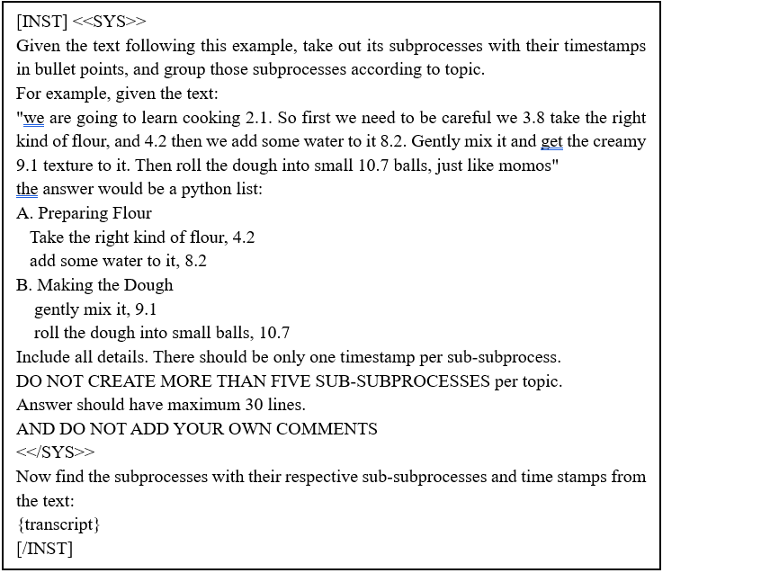
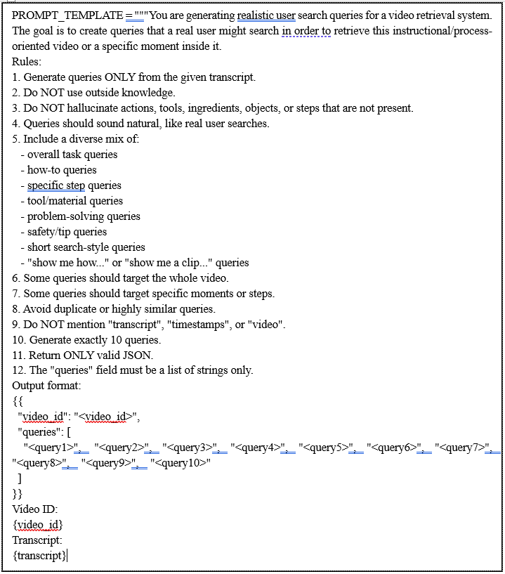

# Appendix

This appendix accompanies the paper and contains the material that did not fit in the 6-page version:

- [A. Segmentation prompt](#a-segmentation-prompt)
- [B. Query-generation prompt](#b-query-generation-prompt)
- [C. Cosine-similarity (no-graph) ablation](#c-cosine-similarity-no-graph-ablation)
- [D. Complete results at all cutoffs](#d-complete-results-at-all-cutoffs)

## A. Segmentation prompt

The prompt below is supplied to LLaMA-2 70B together with each timestamped instructional transcript. It instructs the model to identify higher-level procedural stages and their associated timestamped substeps. In the original implementation the prompt uses the terms *subprocess* and *sub-subprocess*; these correspond to the *segment (seg)* and *sub-segment (subseg)* terminology used in the paper.

Plain-text version: [`prompts/segmentation_prompt.txt`](../prompts/segmentation_prompt.txt)

**Example of the resulting structure** (from the paper). The seg *Preparing the Ingredients* contains subsegs such as:

| Seg | Subseg |
|---|---|
| Preparing the Ingredients | Take the butter and spread it everywhere |
| | Take the cheese and start slicing it |
| | Take the bread and put it on the pan |
| Assembling the Sandwich | *(actions related to combining the prepared ingredients)* |

Each seg and subseg is paired with its transcript text and timestamp, preserving its location in the original video.

## B. Query-generation prompt

The prompt below is used with GPT-3.5 Turbo for LLM-assisted query generation. The same prompt is used for YouCook-II and all four WikiHow categories.

Plain-text version: [`prompts/query_generation_prompt.txt`](../prompts/query_generation_prompt.txt)

## C. Cosine-similarity (no-graph) ablation

To isolate the contribution of graph-based process modeling, the retrieval pipeline is evaluated with PMKG construction and all GNN components disabled. Queries and candidate segments are represented with the same text encoders used in the main experiments, and candidates are ranked solely by cosine similarity between their embeddings. No graph relations, message passing, graph-enhanced representations, or graph-based candidate expansion are used.

**Table IV.** Cosine-similarity ablation with graph construction and GNN components disabled. Retrieval is performed directly from text embeddings.

| Dataset | Encoder | MRR | Recall@1 | Recall@3 | Recall@5 | Recall@10 | NDCG@1 | NDCG@3 | NDCG@5 | NDCG@10 |
|---|---|---|---|---|---|---|---|---|---|---|
| Processed YouCook-II | MiniLM | 0.6819 | 0.0543 | 0.1405 | 0.2067 | 0.3125 | 0.5614 | 0.4927 | 0.4540 | 0.4084 |
| Processed YouCook-II | BGE-M3 | 0.5628 | 0.0414 | 0.1106 | 0.1719 | 0.2616 | 0.4293 | 0.3877 | 0.3640 | 0.3294 |
| Processed YouCook-II | Qwen3 | 0.0574 | 0.0018 | 0.0101 | 0.0193 | 0.0456 | 0.0174 | 0.0266 | 0.0312 | 0.0414 |
| WikiHow Food | MiniLM | 0.8816 | 0.0883 | 0.2281 | 0.3265 | 0.4636 | 0.8202 | 0.7371 | 0.6713 | 0.5866 |
| WikiHow Food | BGE-M3 | 0.8039 | 0.0785 | 0.1938 | 0.2748 | 0.3908 | 0.7169 | 0.6227 | 0.5638 | 0.4945 |
| WikiHow Food | Qwen3 | 0.6535 | 0.0619 | 0.1539 | 0.2182 | 0.3137 | 0.5504 | 0.4819 | 0.4361 | 0.3868 |
| WikiHow Sports-Fitness | MiniLM | 0.8248 | 0.1209 | 0.2694 | 0.3508 | 0.4671 | 0.7577 | 0.6341 | 0.5674 | 0.5293 |
| WikiHow Sports-Fitness | BGE-M3 | 0.7523 | 0.1038 | 0.2295 | 0.3020 | 0.4084 | 0.6643 | 0.5506 | 0.4916 | 0.4615 |
| WikiHow Sports-Fitness | Qwen3 | 0.6261 | 0.0844 | 0.1882 | 0.2527 | 0.3508 | 0.5153 | 0.4352 | 0.3994 | 0.3832 |
| WikiHow Computers | MiniLM | 0.8718 | 0.1317 | 0.3046 | 0.4029 | 0.5216 | 0.8281 | 0.7211 | 0.6511 | 0.5941 |
| WikiHow Computers | BGE-M3 | 0.8206 | 0.1217 | 0.2744 | 0.3589 | 0.4626 | 0.7569 | 0.6534 | 0.5846 | 0.5308 |
| WikiHow Computers | Qwen3 | 0.6833 | 0.0987 | 0.2196 | 0.2992 | 0.4013 | 0.6024 | 0.5044 | 0.4631 | 0.4381 |
| WikiHow Health | MiniLM | 0.8439 | 0.1015 | 0.2378 | 0.3266 | 0.4501 | 0.7779 | 0.6756 | 0.6142 | 0.5500 |
| WikiHow Health | BGE-M3 | 0.7792 | 0.0895 | 0.2064 | 0.2767 | 0.3771 | 0.6957 | 0.5894 | 0.5258 | 0.4667 |
| WikiHow Health | Qwen3 | 0.6894 | 0.0745 | 0.1782 | 0.2452 | 0.3479 | 0.5846 | 0.5054 | 0.4595 | 0.4170 |

CSV: [`results/table4_cosine_similarity_ablation.csv`](../results/table4_cosine_similarity_ablation.csv)

## D. Complete results at all cutoffs

The paper shows NDCG@10, Recall@10 and MRR. The full comparison with MRR, Recall@1/5/10 and NDCG@1/5/10 for every dataset is in [`results/README.md`](../results/README.md#table-iii-comparison-with-text-retrieval-methods-all-cutoffs).
